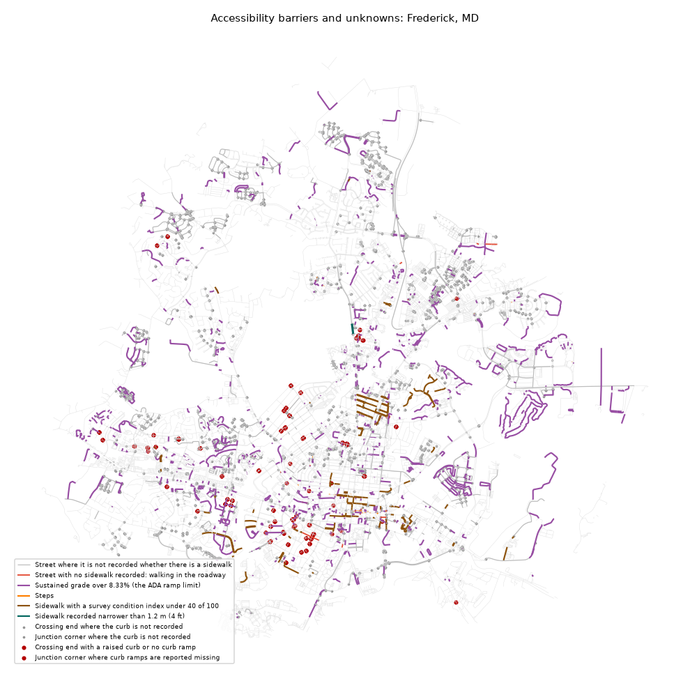

# Accessibility barriers: Frederick, MD

_Generated by `pf barriers` from the enriched graph. Do not edit by hand._

**Internal.** Built in part on data with no stated open license (frederick_county_signals, frederick_ramps, frederick_sidewalk_photos, frederick_sidewalks); not to be shown outside until the owners give written permission (rule 7).

A **barrier** is what a named source recorded on the given date; an **unknown** is a place nobody has recorded. Nothing here certifies a place as accessible. Slope is unknown wherever no elevation model is loaded, so no steep segment can appear before one is.

Walkable network inside the line: 1,200 km.

| type | kind | what | count | km | verified_pct |
|---|---|---|---|---|---|
| curb_barrier | barrier | Crossing end with a raised curb or no curb ramp | 50 |  | 100.0 |
| junction_curb_barrier | barrier | Junction corner where curb ramps are reported missing | 157 |  | 0.0 |
| ramp_fails_check | barrier | Curb ramp that fails its survey (too steep, no landing or damaged) | 172 |  | 100.0 |
| ramp_no_tactile_pad | barrier | Curb ramp with no working tactile warning pad | 1,047 |  | 100.0 |
| steep | barrier | Sustained grade over 8.33% (the ADA ramp limit) | 1,199 | 92.4 | 76.1 |
| steps | barrier | Steps | 57 | 0.3 | 100.0 |
| no_sidewalk | barrier | Street with no sidewalk recorded: walking in the roadway | 18 | 1.0 | 100.0 |
| sidewalk_poor_condition | barrier | Sidewalk with a survey condition index under 40 of 100 | 325 | 19.4 | 69.5 |
| sidewalk_narrow | barrier | Sidewalk recorded narrower than 1.2 m (4 ft) | 5 | 0.4 | 0.0 |
| curb_unknown | unknown | Crossing end where the curb is not recorded | 1,122 |  | 0.0 |
| junction_curb_unknown | unknown | Junction corner where the curb is not recorded | 1,875 |  | 0.0 |
| sidewalk_unknown | unknown | Street where it is not recorded whether there is a sidewalk | 2,472 | 125.2 | 0.0 |

## By census tract (most unknowns per km first)

Tracts with at least 1 km of walkable network inside the line. Full table: [`barriers_by_tract.csv`](barriers_by_tract.csv).

| GEOID | barriers | unknowns | network_km | barriers_per_km | unknowns_per_km |
|---|---|---|---|---|---|
| 24021751203 | 34 | 270 | 25.4 | 1.34 | 10.61 |
| 24021750100 | 104 | 119 | 15.8 | 6.59 | 7.54 |
| 24021751301 | 54 | 578 | 76.7 | 0.7 | 7.54 |
| 24021750504 | 199 | 465 | 71.0 | 2.8 | 6.55 |
| 24021750802 | 71 | 616 | 97.5 | 0.73 | 6.32 |
| 24021750505 | 161 | 281 | 48.1 | 3.35 | 5.84 |
| 24021751202 | 82 | 324 | 59.5 | 1.38 | 5.44 |
| 24021772200 | 230 | 575 | 119.5 | 1.92 | 4.81 |
| 24021750506 | 74 | 233 | 49.2 | 1.5 | 4.73 |
| 24021750801 | 349 | 330 | 72.4 | 4.82 | 4.56 |
| 24021750805 | 239 | 291 | 68.5 | 3.49 | 4.25 |
| 24021751201 | 70 | 260 | 62.1 | 1.13 | 4.19 |
| 24021750508 | 77 | 143 | 38.9 | 1.98 | 3.68 |
| 24021751701 | 57 | 110 | 44.3 | 1.29 | 2.48 |
| 24021750804 | 52 | 93 | 39.1 | 1.33 | 2.38 |

